<picture>
  <source media="(prefers-color-scheme: dark)" srcset="assets/banner-dark.svg">
  
</picture>

I'm in the **MVA master (Mathématiques, Vision, Apprentissage) at ENS Paris-Saclay**, as the final year of my engineering degree at École des Ponts. I work on machine learning for time series and biosignals, mostly EEG.

**Looking for a 6-month research internship from April 2027.**

### Research

- **EEG decoding of attentional engagement during gameplay** · UQAM, Montréal, on Ubisoft La Forge data 
  Multivariate EMD, Wigner-Ville energies and Riemannian covariance features, evaluated leave-one-subject-out on 26 players, with eye-tracking and permutation controls to check what the classifier actually picks up. First-author paper submitted to IEEE ISCAS 2027.
- **Time-frequency Granger causality between EEG and ECG during sleep** · [repo](https://github.com/luchocomputor/Medical-Time-Series-Research-Project) 
  Wavelet decomposition and VAR models to track state-dependent brain-heart interactions. Poster at the International Summer Institute on Network Physiology, Lake Como, 2025.

### Projects

- **[Martha](https://github.com/luchocomputor/martha)** · native iOS app that digitises a wardrobe and suggests outfits with vision and language models. SwiftUI, CoreData, Supabase, Gemini; about 22k lines.
- **[QRT Data Challenge 2025](https://github.com/luchocomputor/QRT_DataChallenge2025)** · survival prediction for leukaemia patients from clinical and molecular data (with Institut Gustave Roussy). IPCW C-index 0.755 on the public leaderboard.

### Previously

Machine learning intern at Caisse des Dépôts (LambdaMART learning-to-rank for emerging-market equity allocation) · data science intern at Sopra Steria.

### Tools

<picture>
  <source media="(prefers-color-scheme: dark)" srcset="https://skillicons.dev/icons?i=py%2Cpytorch%2Csklearn%2Cswift%2Csupabase%2Clatex%2Cgit&theme=dark">
  
</picture>

