<picture>
  <source media="(prefers-color-scheme: dark)" srcset="assets/banner-dark.svg">
  
</picture>

I'm in the **MVA master (Mathématiques, Vision, Apprentissage) at ENS Paris-Saclay**, as the final year of my engineering degree at École Nationale des Ponts et Chaussées. I work on machine learning for time series and biosignals, mostly EEG.

**Looking for a 6-month research internship from April 2027.**

 

## Research

<a href="https://github.com/luchocomputor/flow-state-uqam"><picture>
  <source media="(prefers-color-scheme: dark)" srcset="assets/titles/uqam-dark.svg">
  
</picture></a>

26 skilled players, about 4 hours of *Apex Legends* each, recorded with a 16-channel EEG headset at Ubisoft La Forge. Flow state has no ground truth, so we built the labels from behaviour: small targets appeared at the edge of the screen, and a long run of missed targets marked a player fully absorbed in the game, contrasted with lobby rest between matches.

Absorbed play vs. rest decodes well across subjects (F1 = 0.76, leave-one-subject-out). Control analyses with eye-tracking, permutation tests and self-supervised probes then showed what the model actually reads: a broad play-vs-rest arousal shift rather than a marker of flow itself. The paper therefore frames the target as **attentional engagement**, not flow.

`EEG-Conformer` `self-supervised learning` `EfficientNet` `Riemannian geometry` `multivariate EMD` `Wigner-Ville` `PyTorch`

**First-author paper submitted to IEEE ISCAS 2027.**

<a href="https://github.com/luchocomputor/flow-state-uqam"><picture><source media="(prefers-color-scheme: dark)" srcset="assets/buttons/code-dark.svg"></picture></a>

 

<a href="https://github.com/luchocomputor/Medical-Time-Series-Research-Project"><picture>
  <source media="(prefers-color-scheme: dark)" srcset="assets/titles/granger-dark.svg">
  
</picture></a>

Full-night EEG from the PhysioNet 2018 Challenge database (MGH Sleep Lab, 1,985 subjects). VAR models give temporal and spectral (Geweke) Granger causality between EEG channels, and wavelets make it time-resolved, to follow how these directed interactions change across sleep stages.

`Granger causality` `VAR models` `wavelets` `time-frequency analysis` `sleep EEG`

**First-author poster at the International Summer Institute on Network Physiology, Lake Como, 2025.**

<a href="https://github.com/luchocomputor/Medical-Time-Series-Research-Project"><picture><source media="(prefers-color-scheme: dark)" srcset="assets/buttons/repo-dark.svg"></picture></a>&nbsp;
<a href="https://github.com/luchocomputor/Medical-Time-Series-Research-Project/blob/main/POSTER.pdf"><picture><source media="(prefers-color-scheme: dark)" srcset="assets/buttons/poster-dark.svg"></picture></a>

 

## Projects

<picture>
  <source media="(prefers-color-scheme: dark)" srcset="assets/titles/challenge-dark.svg">
  
</picture>

Decoding which image a person is looking at from their EEG, on public datasets through Meta's NeuralBench framework. First submissions: ridge regression from EEG to image embeddings, fitted on about a million EEG epochs from Alljoined.

`EEG decoding` `image embeddings` `ridge regression` `NeuralBench`

<a href="https://neural-interfaces26.github.io/"><picture><source media="(prefers-color-scheme: dark)" srcset="assets/buttons/challenge-dark.svg"></picture></a>

 

<a href="https://github.com/luchocomputor/martha"><picture>
  <source media="(prefers-color-scheme: dark)" srcset="assets/titles/martha-dark.svg">
  
</picture></a>

Native app that digitises a wardrobe from photos and suggests outfits with vision and language models. About 22k lines of Swift, from data model and backend to interface.

`SwiftUI` `CoreData` `Supabase` `Gemini vision`

<a href="https://github.com/luchocomputor/martha"><picture><source media="(prefers-color-scheme: dark)" srcset="assets/buttons/repo-dark.svg"></picture></a>

 

<picture>
  <source media="(prefers-color-scheme: dark)" srcset="assets/titles/qrt-dark.svg">
  
</picture>

Overall survival prediction for leukaemia patients from clinical and molecular data.

`survival analysis` `Cox models` `random survival forests` `LightGBM` `scikit-survival`

**IPCW C-index of 0.755 on the public leaderboard.**

 

## Experience

<picture>
  <source media="(prefers-color-scheme: dark)" srcset="assets/titles/cdc-dark.svg">
  
</picture>

Learning-to-rank (LambdaMART) to allocate across emerging-market equity indices, with purged, embargoed time-series cross-validation against look-ahead bias.

 

<picture>
  <source media="(prefers-color-scheme: dark)" srcset="assets/titles/sopra-dark.svg">
  
</picture>

Root-cause analysis of metro delays for an RATP line-automation project.

 

## Activity

<picture>
  <source media="(prefers-color-scheme: dark)" srcset="https://raw.githubusercontent.com/luchocomputor/luchocomputor/output/contrib-dark.svg">
  
</picture>

 

## Tools

<picture>
  <source media="(prefers-color-scheme: dark)" srcset="https://skillicons.dev/icons?i=py%2Cpytorch%2Csklearn%2Cswift%2Csupabase%2Clatex%2Cgit&theme=dark">
  
</picture>

 

<a href="https://github.com/luchocomputor/cv/blob/main/cv.pdf"><picture><source media="(prefers-color-scheme: dark)" srcset="assets/buttons/cv-dark.svg"></picture></a>&nbsp;
<a href="https://www.linkedin.com/in/louis-almairac"><picture><source media="(prefers-color-scheme: dark)" srcset="assets/buttons/linkedin-dark.svg"></picture></a>&nbsp;
<a href="mailto:louis.almairac@enpc.fr"><picture><source media="(prefers-color-scheme: dark)" srcset="assets/buttons/email-dark.svg"></picture></a>

